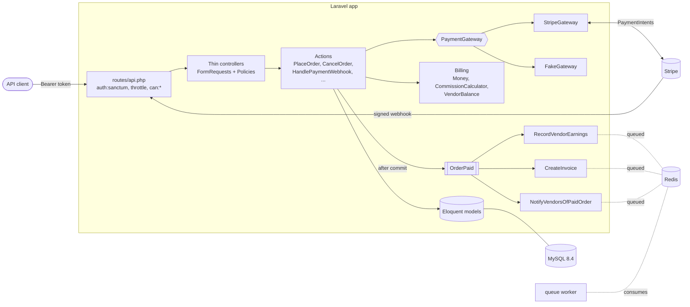
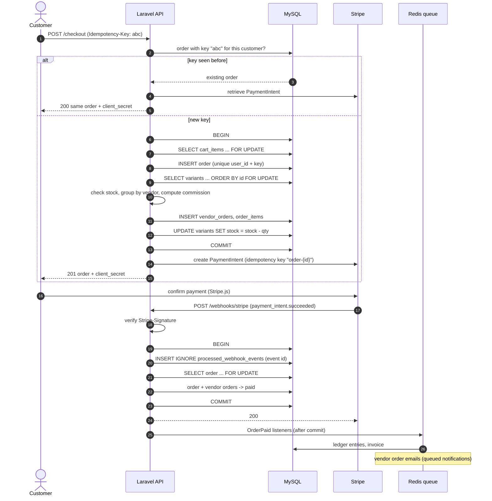
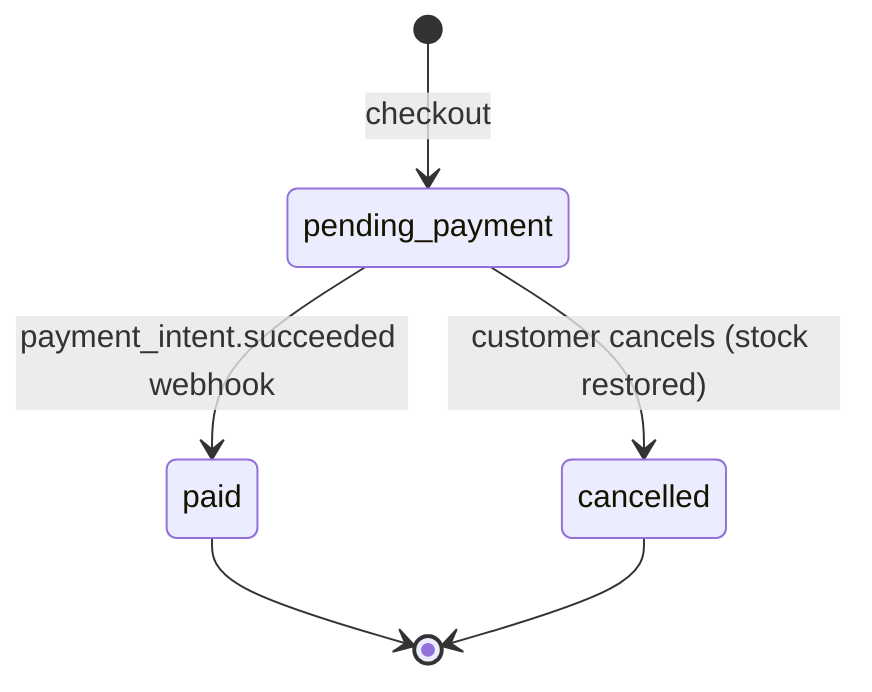
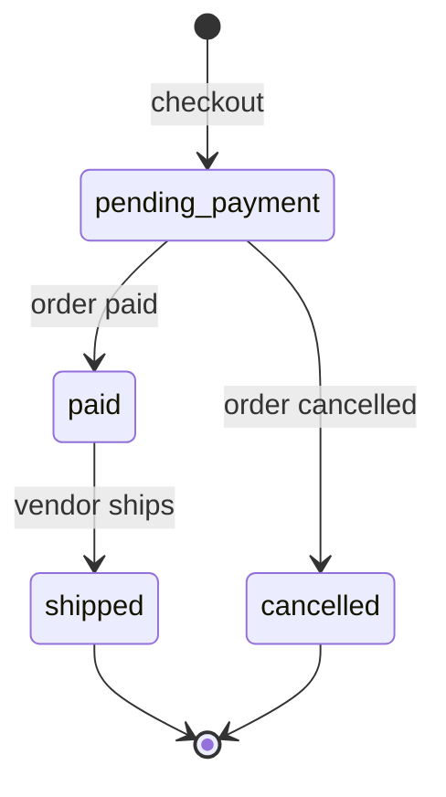

# marketplace-api-laravel

[](https://github.com/hareshnarola101/marketplace-api-laravel/actions/workflows/ci.yml)

A multi-vendor marketplace REST API built with Laravel 13 and PHP 8.3. Customers buy from several vendors in one checkout, the order is split per vendor, Stripe takes the payment, and the platform keeps a commission that is recorded in a ledger.

I have built this kind of system several times for clients: marketplaces, payment integrations, vendor payouts. This repository is a small, complete version of it that shows how I handle the parts that usually go wrong in production: overselling, double charges, duplicate webhooks and rounding errors in money.

## What it does

- **Accounts and roles.** Customers, vendors and admins. Token auth with Sanctum, policies and gates for authorization, rate limiting on login and registration.
- **Vendor onboarding.** A customer applies to sell, an admin approves or rejects the application. Only approved vendors can list products.
- **Catalog.** Products with variants (SKU, price, stock), soft deletes, and search/filter/sort through query scopes.
- **Cart and split checkout.** One checkout creates one `Order` and one `VendorOrder` per vendor. Stock is decremented inside a transaction with row locks. Checkout requires an `Idempotency-Key` header.
- **Payments.** A `PaymentGateway` interface with a Stripe implementation (PaymentIntents via stripe-php) and an in-memory fake for tests and offline development. A signed webhook marks the order paid, and receiving it twice has no effect.
- **Commission and payouts.** A platform rate (default 10%) that admins can override per vendor. Everything is integer cents. Sales and commissions go into an append-only ledger, and vendors get a payout summary computed from it.
- **Queued side effects.** `OrderPaid` triggers three queued listeners (ledger, invoice, vendor emails), each with retries, backoff and a `failed()` hook.

## Architecture



Code layout:

```
app/
  Actions/        one class per use case (Checkout/PlaceOrder, Orders/CancelOrder, Payments/HandlePaymentWebhook, ...)
  Billing/        CommissionCalculator, VendorBalance, value objects for splits and summaries
  Enums/          statuses with their allowed transitions
  Events/ Listeners/ Notifications/
  Exceptions/     ApiException subclasses and one renderer for the JSON error format
  Http/           controllers, FormRequests, API Resources
  Models/         relationships, casts, scopes, small state-transition helpers
  Payments/       PaymentGateway interface, StripeGateway, FakeGateway, DTOs
  Policies/
  Support/Money.php
```

## Checkout and payment flow



## Order states



Each vendor's part of the order has its own status:



Allowed transitions live on the enums (`OrderStatus::canTransitionTo()`, `VendorOrderStatus::canTransitionTo()`). Anything else returns `409 invalid_state_transition`.

## Quickstart

Requirements: Docker with Compose. Nothing else needs to be installed on the host.

```bash
git clone https://github.com/hareshnarola101/marketplace-api-laravel.git
cd marketplace-api-laravel
docker compose up -d --build
docker compose exec app php artisan migrate --seed
```

The API is now at `http://localhost:8000/api/v1`. On first start the `app` container installs Composer dependencies into the mounted source, creates `.env` from `.env.example` and generates an app key, so it can take a minute before it reports healthy. The `queue` service starts once `app` is healthy and processes jobs from Redis.

On Linux, if your user id is not 1000, build with `UID=$(id -u) GID=$(id -g) docker compose up -d --build` so files written by the container belong to you. If port 8000 is taken, set `APP_PORT`.

Demo accounts (the password is `password` for all of them):

| Email | Role |
|---|---|
| `admin@example.com` | admin |
| `customer@example.com` | customer |
| `vendor1@example.com` | vendor "Northwind Outfitters", default 10% commission |
| `vendor2@example.com` | vendor "Blue Harbor Ceramics", 15% commission |
| `vendor3@example.com` | vendor "Copper Kettle Coffee", 8% commission |
| `applicant@example.com` | customer with a pending vendor application |

Payments use the fake gateway by default, so everything works offline. To use Stripe in test mode, set `PAYMENT_GATEWAY=stripe`, `STRIPE_SECRET=sk_test_...` and `STRIPE_WEBHOOK_SECRET=whsec_...` in `.env`, then forward webhooks with the Stripe CLI:

```bash
stripe listen --forward-to localhost:8000/api/v1/webhooks/stripe
```

## API examples

All responses are JSON. Money is always `{"amount": <cents>, "currency": "USD", "formatted": "19.99"}`.

```bash
API=http://localhost:8000/api/v1
JSON=(-H 'Accept: application/json' -H 'Content-Type: application/json')

# Log in as the demo customer
TOKEN=$(curl -s "${JSON[@]}" -X POST $API/auth/login \
  -d '{"email":"customer@example.com","password":"password"}' | jq -r .token)

# Browse: search, price range in cents, only in stock, cheapest first
curl -s "$API/products?search=mug&min_price=1000&max_price=15000&in_stock=1&sort=price" \
  | jq '.data[] | {name, vendor: .vendor.store_name}'

# Put variants from two different vendors in the cart
V1=$(curl -s "$API/products?vendor=northwind-outfitters&in_stock=1" | jq '.data[0].variants | map(select(.stock > 0))[0].id')
V2=$(curl -s "$API/products?vendor=blue-harbor-ceramics&in_stock=1" | jq '.data[0].variants | map(select(.stock > 0))[0].id')
curl -s "${JSON[@]}" -H "Authorization: Bearer $TOKEN" -X POST $API/cart/items -d "{\"variant_id\": $V1, \"quantity\": 1}"
curl -s "${JSON[@]}" -H "Authorization: Bearer $TOKEN" -X POST $API/cart/items -d "{\"variant_id\": $V2, \"quantity\": 1}"

# Check out. Sending the same key again returns the same order (200, Idempotent-Replayed: true)
KEY=$(uuidgen)
curl -s "${JSON[@]}" -H "Authorization: Bearer $TOKEN" -H "Idempotency-Key: $KEY" -X POST $API/checkout \
  | jq '{id: .data.id, total: .data.total.formatted, payment,
         split: [.data.vendor_orders[] | {vendor: .vendor.store_name, subtotal: .subtotal.formatted,
                                          commission: .commission.formatted, earnings: .vendor_earnings.formatted}]}'
```

With the fake gateway, simulate the customer paying. This sends a `payment_intent.succeeded` event through the same handler the webhook uses; the queue worker then books the ledger, creates the invoice and writes the vendor emails to the log:

```bash
docker compose exec app php artisan orders:simulate-payment 1
docker compose logs queue
```

Vendor and admin endpoints:

```bash
VENDOR=$(curl -s "${JSON[@]}" -X POST $API/auth/login \
  -d '{"email":"vendor2@example.com","password":"password"}' | jq -r .token)
ADMIN=$(curl -s "${JSON[@]}" -X POST $API/auth/login \
  -d '{"email":"admin@example.com","password":"password"}' | jq -r .token)

# Vendor: paid sub-orders, ship one, see earnings
curl -s "${JSON[@]}" -H "Authorization: Bearer $VENDOR" "$API/vendor/orders?status=paid"
curl -s "${JSON[@]}" -H "Authorization: Bearer $VENDOR" -X POST $API/vendor/orders/2/ship
curl -s "${JSON[@]}" -H "Authorization: Bearer $VENDOR" $API/vendor/payouts/summary | jq .data

# Admin: review applications, change a commission rate, record a payout
curl -s "${JSON[@]}" -H "Authorization: Bearer $ADMIN" "$API/admin/vendors?status=pending"
curl -s "${JSON[@]}" -H "Authorization: Bearer $ADMIN" -X POST $API/admin/vendors/4/approve
curl -s "${JSON[@]}" -H "Authorization: Bearer $ADMIN" -X PATCH $API/admin/vendors/2/commission -d '{"commission_rate_bps": 1200}'
curl -s "${JSON[@]}" -H "Authorization: Bearer $ADMIN" -X POST $API/admin/vendors/2/payouts -d '{"amount": 500}'
```

Errors always have the same shape, whatever caused them:

```json
{
  "error": {
    "code": "insufficient_stock",
    "message": "Not enough stock for MUG-BLUE-01: requested 3, available 2.",
    "details": { "sku": "MUG-BLUE-01", "requested": 3, "available": 2 }
  }
}
```

Codes include `validation_failed`, `unauthenticated`, `forbidden`, `not_found`, `too_many_requests`, `empty_cart`, `insufficient_stock`, `product_unavailable`, `invalid_state_transition`, `insufficient_balance`, `payment_gateway_error` and `invalid_signature`.

<details>
<summary>All endpoints</summary>

| Method | Path | Who |
|---|---|---|
| POST | `/auth/register`, `/auth/login` | anyone (rate limited) |
| POST | `/auth/logout` · GET `/auth/me` | signed in |
| GET | `/products`, `/products/{slug}` | anyone |
| GET | `/cart` · POST `/cart/items` · PATCH/DELETE `/cart/items/{id}` | signed in, own cart |
| POST | `/checkout` | signed in |
| GET | `/orders`, `/orders/{id}` · POST `/orders/{id}/cancel` | order owner (admins can view) |
| GET/POST | `/vendor/application` | signed in |
| CRUD | `/vendor/products` · POST `/vendor/products/{id}/variants` · PATCH `/vendor/variants/{id}` | approved vendor, own products |
| GET | `/vendor/orders` · POST `/vendor/orders/{id}/ship` | approved vendor, own sub-orders |
| GET | `/vendor/payouts/summary` | approved vendor |
| GET | `/admin/vendors` · POST `/admin/vendors/{id}/approve`, `/admin/vendors/{id}/reject` | admin |
| PATCH | `/admin/vendors/{id}/commission` · POST `/admin/vendors/{id}/payouts` | admin |
| POST | `/webhooks/stripe` | Stripe (signature checked) |

</details>

## How overselling and double payment are prevented

**Overselling.** The cart never reserves stock; it only checks it for quick feedback. The real check happens in `PlaceOrder` inside one database transaction:

1. The customer's cart rows are locked (`SELECT ... FOR UPDATE`), so two checkouts by the same person run one after the other.
2. Every variant in the cart is locked, always in primary key order. Two customers buying overlapping items take the locks in the same sequence, so they wait for each other instead of deadlocking.
3. Stock is checked against the locked rows and decremented in the same transaction. If any line is short, the whole transaction rolls back with `409 insufficient_stock` and nothing changes.

A second customer racing for the last unit blocks on step 2 until the first commits, then sees `stock = 0` and gets a 409. The test suite covers this sequentially (`OversellProtectionTest`). A truly concurrent test needs two database connections, which I left out to keep the suite fast and deterministic.

**Double checkout.** `orders` has a unique index on `(user_id, idempotency_key)`. A retried request with the same key returns the original order and its PaymentIntent with `200` instead of `201`. If two requests with the same key arrive at the same moment, one wins the insert and the other catches the unique violation (or finds the cart already empty) and returns the winner's order.

**Double charge at Stripe.** The PaymentIntent is created after the transaction commits, so no row locks are held during an HTTP call. It is created with Stripe's own idempotency key `order-{id}`. If that call fails or times out, the order stays `pending_payment`, the API returns `502`, and the client retries checkout with the same `Idempotency-Key`; Stripe returns the same intent instead of creating a second one.

**Duplicate webhooks.** Stripe delivers webhooks at least once, sometimes concurrently. `HandlePaymentWebhook` does two things in one transaction:

1. `INSERT IGNORE` the Stripe event id into `processed_webhook_events`. If the row already exists, the event was handled and we return 200 straight away.
2. Lock the order row and only move it to `paid` if it is still `pending_payment` and the amount and currency match the order total.

Because the event id and the status change commit together, a crash halfway leaves neither, and Stripe's retry processes the event cleanly. A different event for an already-paid order is a no-op. `OrderPaid` implements `ShouldDispatchAfterCommit`, so listeners never run for a transaction that rolled back.

**Retried listeners.** Ledger rows have a unique index on `(vendor_order_id, type)` and are written with `firstOrCreate`; invoices are unique per order. A listener that fails halfway and retries cannot double-book.

## Commission math

All amounts are integer cents held in a `Money` value object. Commission rates are integer basis points (1 bps = 0.01%, so 1000 bps = 10%). No floats are involved anywhere.

```
commission      = intdiv(subtotal × rate_bps + 5000, 10000)    // round half up to the cent
vendor_earnings = subtotal − commission
```

- Commission is computed once per vendor order on its subtotal, not per line item, so rounding happens once and cannot accumulate.
- The vendor gets the remainder, so `commission + vendor_earnings == subtotal` for every amount. A unit test checks this against random amounts and rates.
- The rate used is copied onto the vendor order at checkout. Changing a vendor's rate later only affects new orders.

Example: a vendor on 12.5% (1250 bps) sells an item for $19.99.

```
1999 × 1250 = 2,498,750
intdiv(2,498,750 + 5,000, 10,000) = 250 cents commission   (exact value 249.875)
vendor earnings = 1999 − 250 = 1749 cents
```

The ledger stores a positive `sale` entry and a negative `commission` entry per vendor order, plus negative `payout` entries when the platform pays a vendor. The payout summary is a `SUM` over the ledger grouped by type. Balances are never stored separately, so there is no second number that can drift.

## Running tests

```bash
# Inside the running container (SQLite in memory, about 10 seconds)
docker compose exec app vendor/bin/pest

# Against MySQL, the same way CI runs it
docker compose exec -e DB_CONNECTION=mysql -e DB_HOST=db -e DB_DATABASE=testing app vendor/bin/pest

# Code style and static analysis
docker compose exec app vendor/bin/pint --test
docker compose exec app vendor/bin/phpstan analyse
```

The suite has unit tests for `Money` and `CommissionCalculator`, and feature tests for auth and rate limiting, vendor onboarding, catalog filters, the cart, checkout splitting, idempotency, oversell protection, webhook signatures and idempotency, the queued listeners, commission and payouts, and authorization at every role boundary. Laravel's fakes are used where they make a test clearer: `Event::fake` for webhook outcomes, `Queue::fake` to check that listeners are queued with the right retry settings, `Notification::fake` for vendor emails, and a Mockery double for a payment provider outage.

The webhook tests use the real `StripeGateway` and Stripe's own signature verification. They sign payloads with a test secret, so no network access is needed.

GitHub Actions runs Pint, Larastan (level 7) and the Pest suite against a MySQL 8.4 service container on every push and pull request.

## Design decisions and trade-offs

- **Actions instead of fat models or one big service.** Each use case is one class with one entry point. Models keep relationships, casts, scopes and small state helpers. Controllers validate, authorize, call an action and return a resource.
- **Pessimistic locking for stock.** I chose `SELECT ... FOR UPDATE` over optimistic version columns because a checkout touches several rows at once, and I want competing checkouts to wait rather than fail and retry. For flash sales on a single hot SKU I would move the counter to Redis or a reservation table.
- **The payment call happens outside the transaction.** Holding row locks during a network call to Stripe would block every other buyer of those items. The cost is a short window where an order exists without a PaymentIntent, which the idempotency key covers.
- **Webhooks are the source of truth for "paid".** The client's confirmation is never trusted, and the webhook handler checks that the amount received matches the order total.
- **One settlement currency.** Prices, orders and the ledger use one platform currency (`MARKETPLACE_CURRENCY`). `Money` refuses to mix currencies, so adding multi-currency later fails loudly instead of silently.
- **A ledger instead of a balance column.** Append-only entries make every number traceable to an order and make retries safe. The cost is a `SUM` per summary request, which is fine at this scale and easy to snapshot later.
- **Fake gateway behind the same interface.** Tests and local development run offline. If the fake gateway is configured in production, resolving it throws instead of silently accepting orders.
- **`php artisan serve` in Docker.** Good enough for a demo with `PHP_CLI_SERVER_WORKERS=4`. A production image would run php-fpm behind nginx, or FrankenPHP.
- **SQLite for local tests, MySQL in CI.** SQLite keeps the inner loop fast; CI runs the same suite on MySQL so locking and constraint behaviour is checked against the real database.

## What I'd add next

- **Expire abandoned orders.** A scheduled job that cancels `pending_payment` orders older than about 30 minutes, cancels their PaymentIntents and restores stock. Today stock stays reserved until the customer cancels.
- **Refunds.** A `refunded` state, partial refunds per vendor order, and reversing ledger entries. This would also cover the rare case of a payment succeeding for an order that was already cancelled, which is currently logged for manual follow-up.
- **Real payouts through Stripe Connect**, replacing the manually recorded payout entries.
- **Shipping and tax** per vendor order.
- **A concurrency test** that runs two checkouts on separate MySQL connections to show the locking under real contention.
- **An OpenAPI spec** built from the FormRequests and Resources.
- **Full-text search** (MySQL FULLTEXT, or Meilisearch through Scout) once `LIKE` queries stop being enough.

## License

MIT. See [LICENSE](LICENSE).
